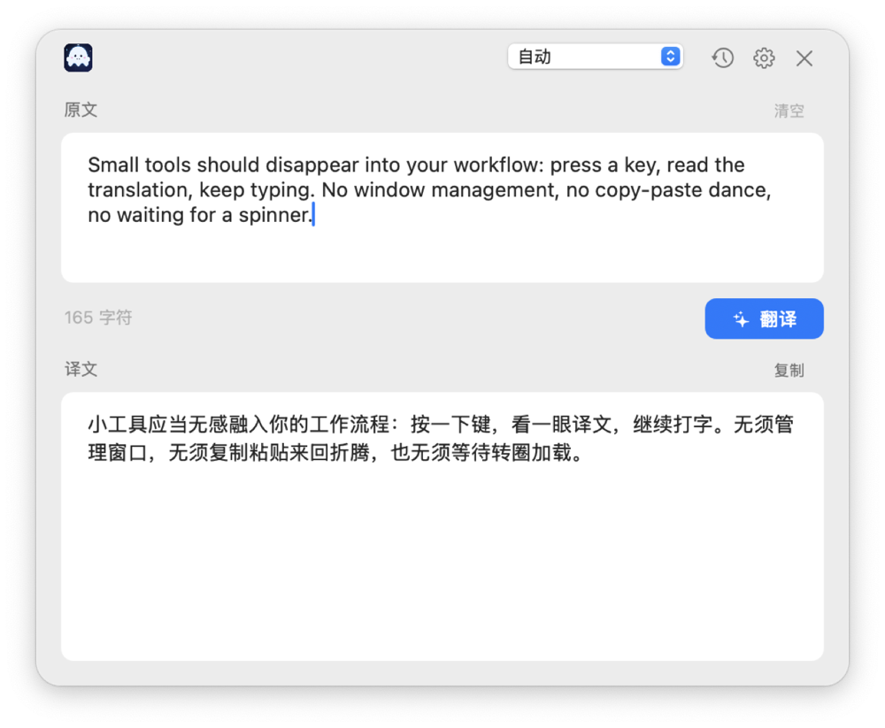
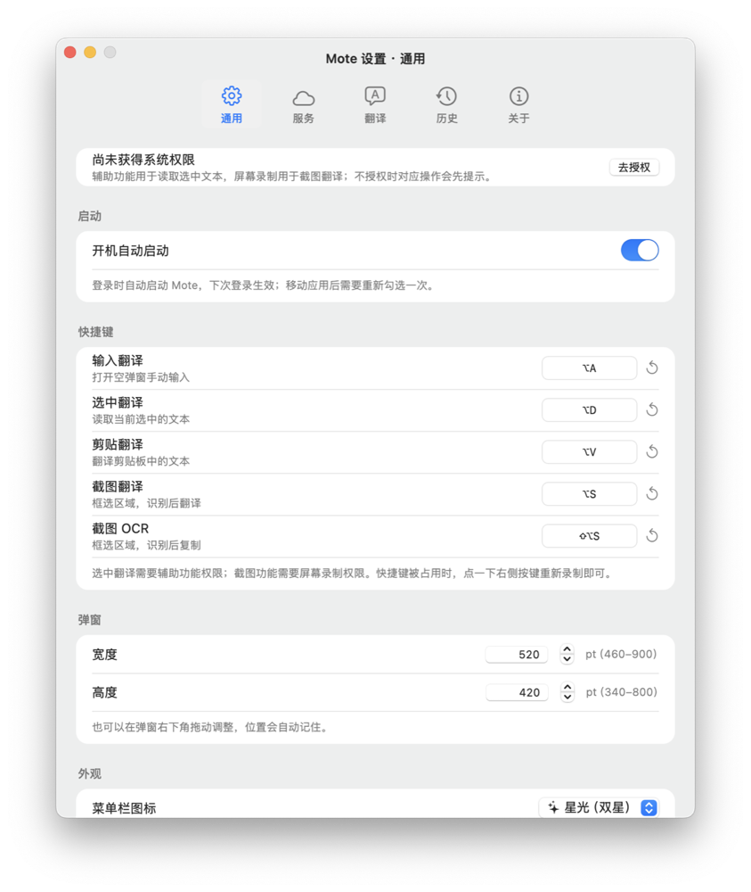
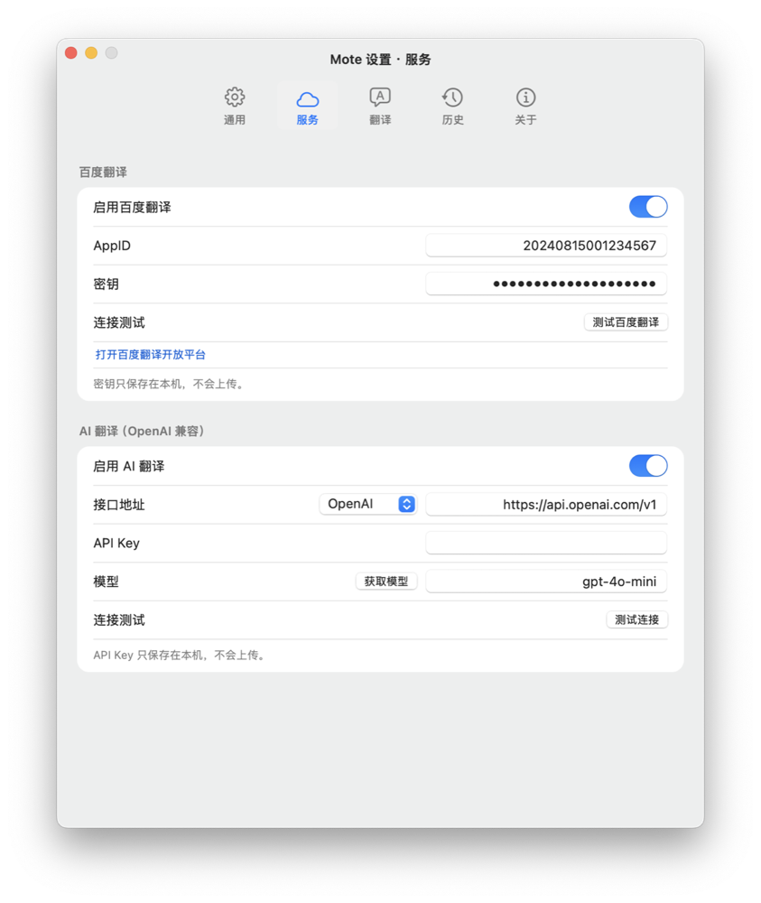
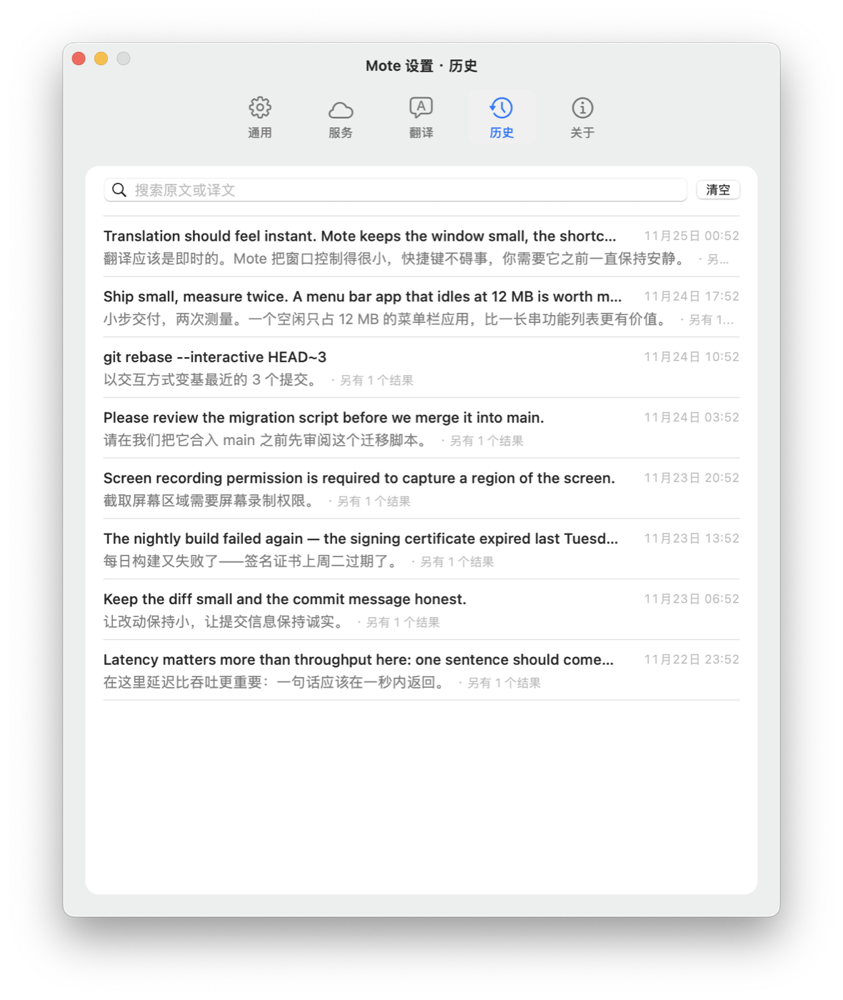
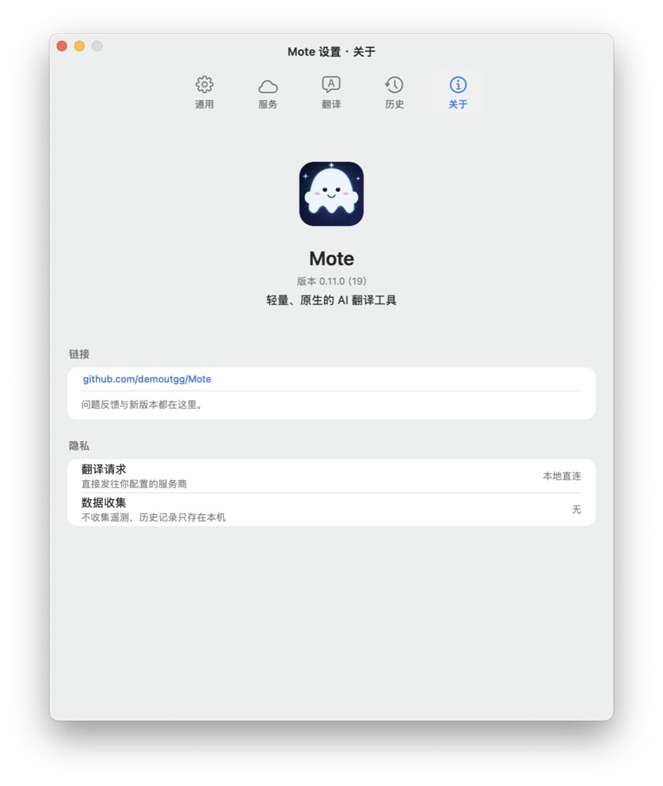
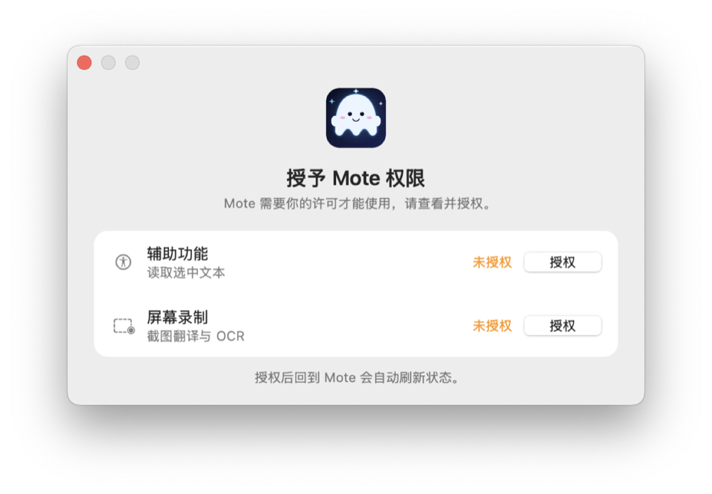

# Mote

轻量、原生的 AI 翻译工具：选中文本或框选屏幕，按一下快捷键，译文就地流式出现。

macOS 菜单栏常驻 · Windows 托盘常驻 · 自带 Key 接任意 OpenAI 兼容服务，也可同时挂百度翻译 · 历史与配置只留本机。



## 截图

| 设置 · 通用 | 设置 · 服务 |
| --- | --- |
|  |  |

| 设置 · 历史 | 设置 · 关于 |
| --- | --- |
|  |  |



## 安装

到 [Releases](https://github.com/demoutgg/Mote/releases/latest) 下载 `Mote-<版本>-macos.dmg` 或 `.zip`。当前构建使用 **ad-hoc 签名**、未经公证，首次打开需要右键点应用 → 打开 → 确认，或者先去掉隔离标记：

```bash
xattr -dr com.apple.quarantine /Applications/Mote.app
```

从源码构建需要 macOS 13+ 与 Swift 6：

```bash
cd macos
./scripts/install.sh      # 构建并安装到 /Applications
./scripts/build-app.sh    # 只打包到 macos/dist/Mote.app
```

更多见 [docs/BUILD.md](docs/BUILD.md)。

## 用法

### 快捷键

| 功能 | 默认 | 说明 |
| --- | --- | --- |
| 输入翻译 | `⌥A` | 唤起空弹窗手动输入，Enter 翻译，`⇧⌥⌘ + Enter` 换行 |
| 选中翻译 | `⌥D` | 读取当前选中的文本，在鼠标附近就地翻译 |
| 剪贴板翻译 | `⌥V` | 翻译剪贴板内容 |
| 截图翻译 | `⌥S` | 框选屏幕区域，识别后翻译 |
| 截图 OCR | `⇧⌥S` | 框选区域只识别并复制，不弹翻译窗 |

五个快捷键都能在设置里点击录制替换，系统保留组合（如 `⌘Q`）会被拒绝并提示。Windows 默认为 `Alt` 系列，同样可录制。

### 权限

macOS 上按需申请，缺哪个就在读不到内容时弹引导窗，不会静默失败：

| 权限 | 用途 |
| --- | --- |
| 辅助功能 | 读取其他应用里选中的文本 |
| 屏幕录制 | 截图翻译、截图 OCR |

引导窗会跟着系统设置窗口浮出一张可拖动的应用卡片，把 Mote 拖进列表即可，两项都授权后自动关闭。设置 → 通用里缺权限时会显示提醒条，点「去授权」可重新发起。

> ad-hoc 签名意味着每次重新编译系统都会把 Mote 当成新应用，需要重新授权一次。

## 功能

**取词**：输入翻译、选中翻译、剪贴板翻译、截图翻译、截图 OCR。

**翻译**

- AI 与百度可同时启用，弹窗按服务分段显示，每段带服务名与分隔线；只开一个服务时不显示标题
- 流式输出，边生成边显示；内置针对翻译场景的系统提示词，可改可恢复默认
- 预填 OpenAI、DeepSeek、Ollama、LM Studio 的接口地址与常用模型，支持一键拉取模型列表

**交互**

- 弹窗大小可拖动调整并记住位置，Esc 或切走焦点即收起
- 菜单栏图标可从内置 SF Symbols 里挑，也能填任意符号名，留空显示「译」
- 本地历史保留最近 100 条，可搜索、复制原文/译文、清空

**其他**：开机自动启动；密钥存系统钥匙串（Windows 用凭据管理器），不写进配置文件。

## 资源占用

OCR 在独立子进程 `MoteOCR` 里跑，识别完立即退出，主应用不常驻 Vision：

| 场景 | 占用 |
| --- | --- |
| 主应用空闲（只在菜单栏） | 约 12 MB |
| 打开设置页 | 约 28 MB |
| 弹窗翻译 · 单服务 | 约 18 MB |
| 弹窗翻译 · 双服务 | 约 24–33 MB（峰值约 45 MB） |
| 关闭弹窗后 | 约 31 MB，反复使用不再增长 |
| OCR 子进程 · 框选 900×400 | 约 113 MB |
| OCR 子进程 · 全屏 3600×2338 | 约 246 MB |

以上为主进程 `phys_footprint` 实测值（macOS 15、Apple 芯片，与活动监视器口径一致）。关闭弹窗后回落的底是进程首次建窗后的框架基线，AppKit 的字体与图层缓存不会归还系统，与翻译内容无关。

## 配置

设置窗口分五页，改动即时生效，没有保存按钮：

- **通用**：权限提醒、开机自启、五个快捷键、弹窗尺寸、菜单栏图标
- **服务**：百度翻译（AppID + 密钥）、AI 翻译（接口地址、API Key、模型、预设、测试连接）
- **翻译**：目标语言、随机性、系统提示词
- **历史**：最近 100 条记录，可搜索与清空
- **关于**：版本号、仓库链接、隐私说明

接口地址会被自动归一化，`https://api.openai.com/v1` 与 `.../v1/chat/completions` 都能用；API Key 留空时不发送 `Authorization` 头，方便对接本地 Ollama、LM Studio 或代理。

## Windows

Windows 版功能已与 macOS 对齐：自定义快捷键、系统提示词、自动复制、弹窗尺寸与位置记忆、失焦收起、历史搜索与复制、AI 预设与模型列表。

> **Windows 版尚未经过实机运行自测。** 代码在 macOS 上完成，CI 只验证能编译通过，没有人真正在 Windows 上跑过完整流程。Release 里的 `Mote-<版本>-windows-x64.zip` 属于未验证产物，请自行评估；遇到问题欢迎提 issue 并附系统版本与报错原文。

## 隐私

- API Key 存系统钥匙串 / 凭据管理器，不写入 JSON 配置
- 翻译历史以 JSON 存在本机，最多 100 条，随时可清空
- 文本只发送给你自己配置的翻译服务，Mote 没有服务端，也不做统计上报

## 文档

- [docs/ARCHITECTURE.md](docs/ARCHITECTURE.md)：模块划分与数据流
- [docs/BUILD.md](docs/BUILD.md)：两端构建方式
- [docs/RELEASE.md](docs/RELEASE.md)：签名、打包与发布流程
- [docs/CHANGELOG.md](docs/CHANGELOG.md)：版本记录

## Roadmap

- Developer ID 签名与公证，去掉首次打开的右键步骤
- 应用内检查更新
- Windows 版完成实机自测与预编译产物

## License

MIT
